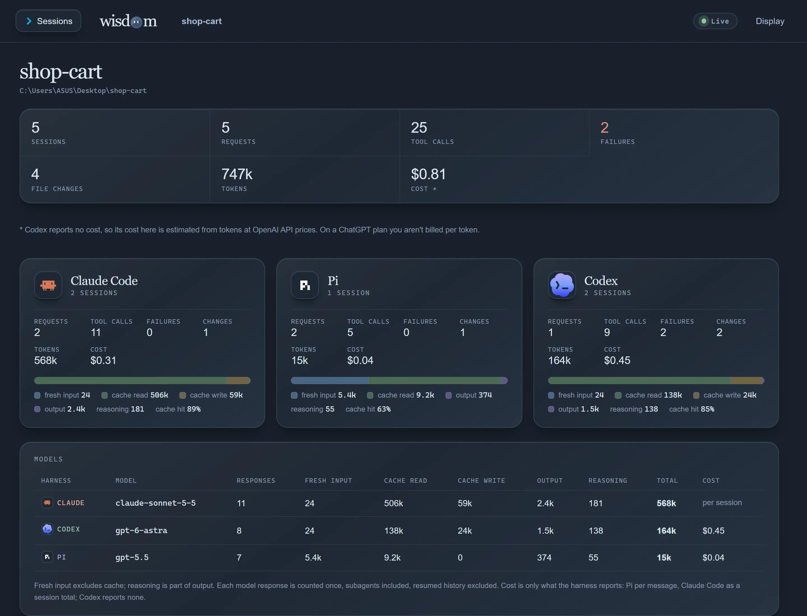

import { Aside, LinkCard, Steps, Tabs, TabItem } from '@astrojs/starlight/components';

Record one session with your normal agent login, then read it back in the terminal, in the
dashboard, and through your agent.

You need:

- Wisdom [installed](../installation/) (Node.js 24 or newer).
- A project folder, ideally a git repository.
- Claude Code, Codex or Pi.

**Rather let your agent install and connect it?** Paste this into Claude Code, Codex or Pi,
started in your project. When it's done, restart the agent there and go on from step 2.

```txt title="Setup prompt" wrap
Set up Wisdom (npm package @oqura/wisdom) in this project:
1. Run `node --version`. If it is older than 24, stop and tell me.
2. Install it globally: `npm install -g @oqura/wisdom`. Do not use npx.
   On Windows PowerShell, use `npm.cmd` and `wisdom.cmd`.
3. In the project's top folder, run `wisdom connect` and show me its output.
4. Run `wisdom doctor` and tell me any problem it finds, with the fix it prints.
Do not edit any other files.
```

<Steps>

1. ### Connect your project

   ```sh title="Terminal"
   cd your-project
   wisdom connect
   ```

   Wisdom adds its hook and reading skill to the project's own agent settings, keeps those
   files out of git, and tells you how to start each agent:

   ```txt title="Output" wrap
   Wisdom is set up in /home/maya/invoice-api. Start your agent here as you always do, with your own login:

     Claude Code  claude   (start it in this folder, not a subfolder)
     Codex        codex    (trust this project if it asks, then review Wisdom's hooks once in /hooks)
     Pi           pi       (start it in this folder, and trust this project when it asks)

   Wisdom added its hook and reading skill to: .claude/settings.local.json, .codex/hooks.json, .pi/settings.json, .claude/skills/wisdom-ledger, .agents/skills/wisdom-ledger.
   They are listed in .git/info/exclude, so git ignores them and they never reach your teammates. wisdom disconnect removes them.
   ```

2. ### Use your agent as usual

   Start it from the project's top folder.

   <Tabs syncKey="agent">
   	<TabItem label="Claude Code">

   	```sh title="Terminal"
   	claude
   	```

   	Nothing else to set up. A session started in a subfolder isn't recorded, because Claude
   	Code loads project settings only from the top folder.

   	</TabItem>
   	<TabItem label="Codex">

   	```sh title="Terminal"
   	codex
   	```

   	The first time, Codex asks you to trust the project. Then run `/hooks` and approve
   	Wisdom's hooks. You do this once per project.

   	</TabItem>
   	<TabItem label="Pi">

   	```sh title="Terminal"
   	pi
   	```

   	The first time, Pi asks you to trust the project.

   	</TabItem>
   </Tabs>

   Ask it for something small, such as a fix with a test.

3. ### Read the session

   In a second terminal, in the same folder:

   ```sh title="Terminal"
   wisdom glance latest
   ```

   You get one entry per turn: your prompt, the start of the agent's reply, and what
   happened (tool calls, failures, changed files). To read a turn in full:

   ```sh title="Terminal"
   wisdom open t1 --capture latest
   ```

   This shows the turn in the order it happened: each tool call with its full input and
   output, the reply, and every file change as a diff.

4. ### Open the dashboard

   ```sh title="Terminal"
   wisdom dashboard
   ```

   It prints an address, `http://127.0.0.1:7435` by default. Open it in your browser to see
   the session update while your agent works.

   

5. ### Ask your agent about it

   The reading skill from step 1 lets any connected agent read past sessions, including ones
   recorded from a different agent. Try:

   ```txt title="Prompt" wrap
   Read the last Wisdom session. What did it change, and did the tests pass?
   ```

</Steps>

<Aside title="Need a separate login per project?">
`wisdom init` and `wisdom track claude` give each agent its own home inside `.wisdom/`. This
also records sessions started from a subfolder. See [Record sessions](../../guides/record-sessions/).
</Aside>

## Next steps

<LinkCard title="Read a session" description="Positions like t3/c2, and what each label means." href="../../guides/read-a-session/" />
<LinkCard title="Read a commit" description="See which step made each part of a commit." href="../../guides/read-a-commit/" />
<LinkCard title="Hand off work" description="Continue in another agent that reads this session first." href="../../guides/hand-off-work/" />
<LinkCard title="Share a session" description="Send one to a teammate, after a secret check." href="../../guides/share-a-session/" />
