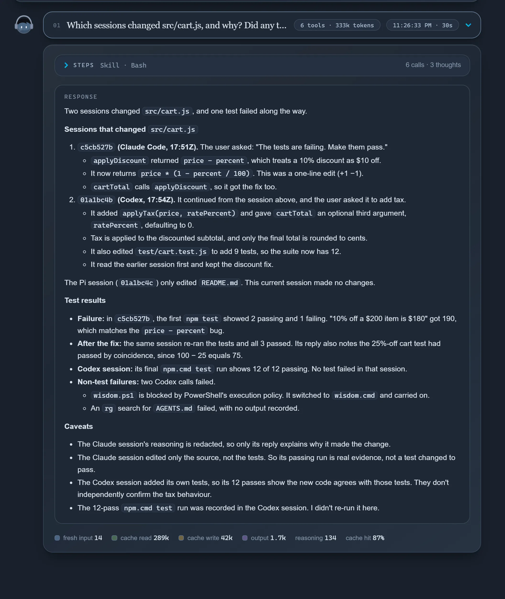

import { Aside, Tabs, TabItem } from '@astrojs/starlight/components';

Your agents read sessions the way you do: `glance`, then `open`. Any agent can read any
session, so Codex can read what Claude Code did, and the other way round.

## The skill

`wisdom connect` and `wisdom init` give each agent a skill that teaches it to run these in its
shell:

```sh
wisdom glance                    # recorded sessions, newest first
wisdom glance latest             # one session: its shape and every turn
wisdom open t3 --capture latest  # turn 3, whole
```

Running `connect` or `init` again updates the skill to match your Wisdom version.
`wisdom doctor` tells you if it's missing or old.

## What to ask

Ask in plain words. The agent finds the session and the turn on its own.

- *Which session changed `src/totals.ts`, and was that on purpose?*
- *Read the last Wisdom session. Did the tests pass before it said they did?*
- *What did the Claude Code session try before it settled on this fix?*

Here an agent checks a change against the request behind it:

```txt frame="terminal"
t3  in        Add a one-line docstring to main() in jev_router/tool.py.

c4  Edit src/optim_jev/tools/jev_router/tool.py · ok · → p1
reply     I added a one-line docstring to main().

p1  src/optim_jev/tools/jev_router/tool.py · modify · +2 −1 · observed during c4
     def main() -> None:
    -    mode = sys.argv[1] if len(sys.argv) > 1 else ""
    +    """Dispatch a JSON request from stdin to the handler named by argv[1]."""
    +    mode =sys.argv[1] if len(sys.argv) > 1 else ""
```

The request and the reply both say "docstring", but the diff shows the line below changed
too. The agent sees the change, the request behind it, and where they differ.



<Aside title="Inside a recorded session, latest can be the agent itself">
The newest session is often the one the agent is running in. To read an earlier one, it runs
`wisdom glance` and names the session's ID. The skill teaches this.
</Aside>

## The MCP tool (optional)

Most agents don't need it. It's for an agent without a shell, or if you'd rather give a tool
than a command. One read-only tool, `ledger`, returns the same text as the CLI. It can't start
an agent or edit code. `wisdom track` already passes it to Claude Code and Codex.

To add it to another agent:

<Tabs syncKey="os">
	<TabItem label="macOS / Linux">

	```json
	{
	  "mcpServers": {
	    "wisdom": {
	      "command": "wisdom",
	      "args": ["mcp", "--data", "/path/to/your-project/.wisdom"]
	    }
	  }
	}
	```

	</TabItem>
	<TabItem label="Windows">

	```json
	{
	  "mcpServers": {
	    "wisdom": {
	      "command": "cmd",
	      "args": ["/c", "wisdom", "mcp", "--data", "C:/path/to/your-project/.wisdom"]
	    }
	  }
	}
	```

	</TabItem>
</Tabs>
