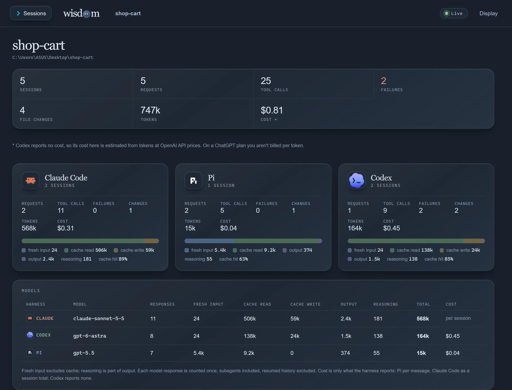
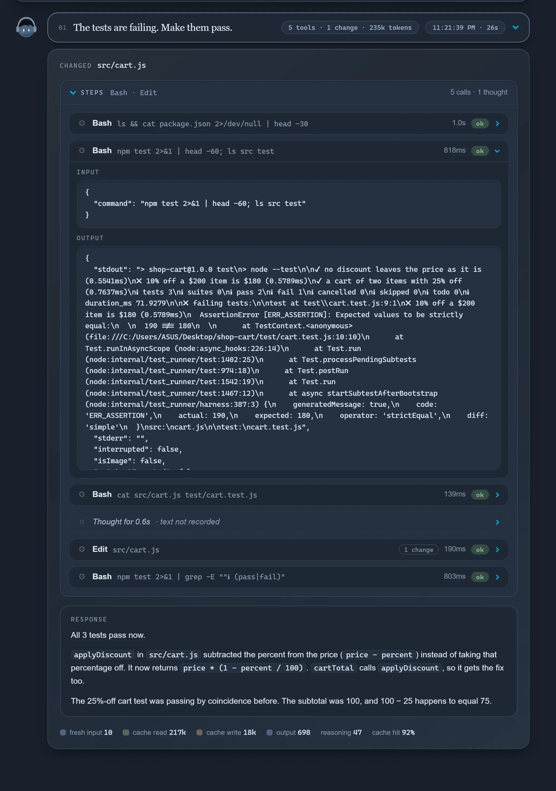
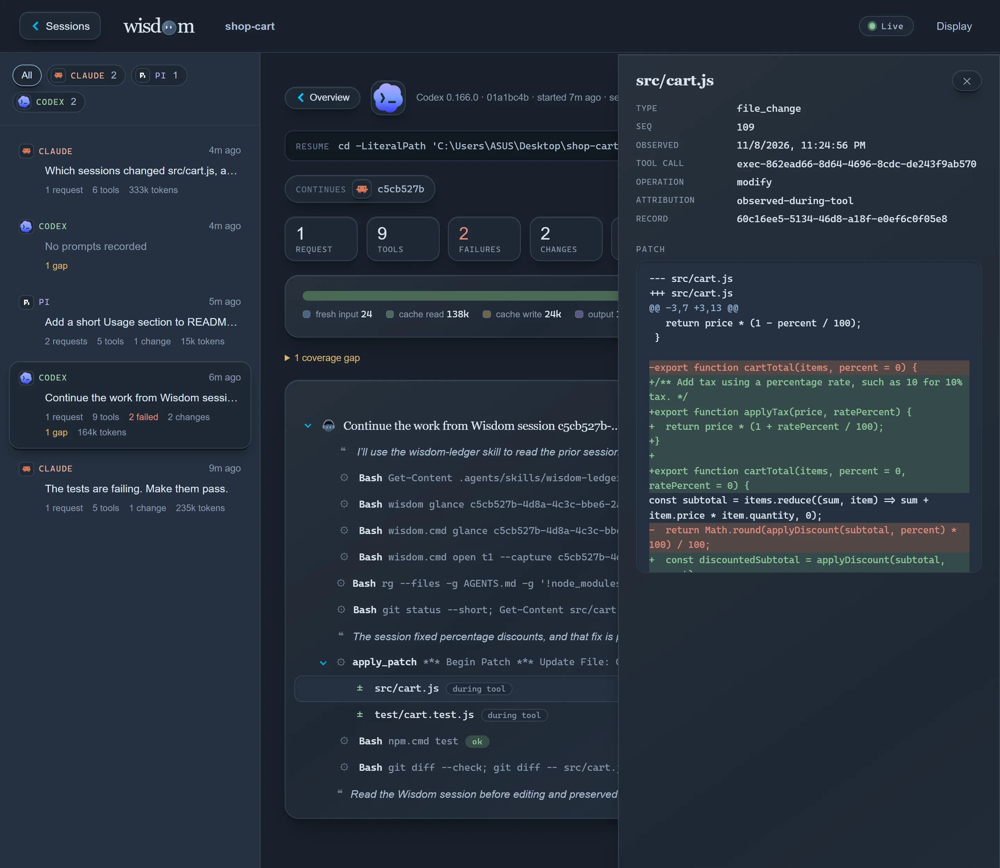

import { Tabs, TabItem } from '@astrojs/starlight/components';

Use the dashboard to browse a project's sessions in your browser, live while your agent works.
It starts with the background service and listens only on your own machine. Your agents read
the same sessions through their skill instead.

```sh
wisdom dashboard        # prints the address, http://127.0.0.1:7435 by default
```

<Tabs>
	<TabItem label="Overview">
	Every session across Claude Code, Codex and Pi, with tool usage, the most-changed files,
	tokens, and disk space.

	
	</TabItem>
	<TabItem label="Chat view">
	A session as a conversation: one box per request, with its steps folded (thinking, each tool
	call, each change) and the response rendered as Markdown.

	
	</TabItem>
	<TabItem label="Dev view">
	The record as a tree: request → tool calls → file changes, with subagents under the call
	that started them. Select any node to inspect its input, output or diff.

	
	</TabItem>
</Tabs>

## Also in the dashboard

| Feature | What it does |
| --- | --- |
| Tokens and cost | Usage per agent, model, session and request. Cost is what the agent reports. Codex reports none, so it's estimated at OpenAI's standard API prices and labelled as an estimate. |
| Continue a session | A command to copy that resumes the session, still recording. |
| Health | The same checks as `wisdom doctor`, at the top of every page. See [Keep it healthy](../keep-it-healthy/). |
| Storage | Space per session, and deleting old ones. |
| Display | Light, Dark and Night themes and a text size, remembered per browser. |

The dashboard never affects recording. If it can't start, capture carries on and
`wisdom doctor` says why. To run the service without it: `wisdom daemon start --no-dashboard`.
