import { Aside } from '@astrojs/starlight/components';

<Aside title="New in 0.6.0, in beta">
Install it with `npm install -g @oqura/wisdom@beta`. Until 0.6.0 is the default,
`npm install -g @oqura/wisdom` gives you 0.5.1, which doesn't have these commands.
</Aside>

[Read a session](../read-a-session/) starts from a session. This page goes the other way:
start from a commit, and see which recorded step wrote each part of it.



Try it on your last commit:

```sh title="Terminal"
wisdom glance --commit HEAD                  # or a hash, or a branch
wisdom open t2/c1 --capture 3f9c2a71         # read a step it names
```

There's nothing to set up. A commit your agent makes, or one you make from its work, is read
the same way.

## From a line of code

Find the commit the way you always do, then follow it into the session:

```sh title="Terminal"
git blame -L 9,10 src/totals.ts        # the commit that wrote these lines: a4c91e2
wisdom glance --commit a4c91e2         # the steps that made them: t2/c1, t2/c4 in 3f9c2a71
wisdom open t2 --capture 3f9c2a71      # the request, the failing test, the fix
```

Three commands take you from a line in your editor to what was asked, what the agent ran, and
what failed before it got there.

## An example

Here the agent from the [home page](/wisdom-docs/) fixed a rounding bug in t2 and committed it
in t3. You also edited the README while nothing was recording.

```txt frame="terminal" title="~/invoice-api" wrap
❯ wisdom glance --commit HEAD
commit a4c91e2b7f30 · fix: round invoice totals once · committed 2026-11-11 09:40Z · version 412
parent 7d2e9b1c04aa · 3 files · 3 pieces: 2 from recorded steps, 1 not recorded
record kept when the commit was made, 2026-11-11 09:40Z
the commit's own diff: git show a4c91e2b7f30

README.md · modify · +1 −0 · not recorded
src/totals.ts · modify · +2 −1
    @@ -9,1 +9,2 @@  t2/c1, t2/c4 in session 3f9c2a71
test/totals.test.ts · create · +14 −0
    @@ -0,0 +1,14 @@  t2/c2 in session 3f9c2a71

sessions
    3f9c2a71-8d4e-4b1a-9c55-2e7f0b6d1a90  claude-code  t2/c1, t2/c2, t2/c4 · window t1–t3
    window: from the start of these sessions (no earlier commit of yours on this branch), up to this commit

To read a step, open its position in its session, such as {"capture":"3f9c2a71","open":"t2/c1"}.

guide · plain, built from the record now, no model · derived, not evidence · not stored; a model guide on request: wisdom guide a4c91e2b7f30
    ## Summary
    fix: round invoice totals once. Written by Wisdom from the commit's record, without a model: which recorded step made each piece and what was asked in that turn. It does not say why beyond those requests.

    ## Items
    - README.md (modify) · not recorded
      No recording explains this change.
    - src/totals.ts @@ -9,1 +9,2 @@ · t2/c1, t2/c4 in session 3f9c2a71
      Made by [t2/c1 3f9c2a71] (claude-code). Asked in t2: "fix it and add a test". Made by [t2/c4 3f9c2a71] (claude-code).
    - test/totals.test.ts @@ -0,0 +1,14 @@ · t2/c2 in session 3f9c2a71
      Made by [t2/c2 3f9c2a71] (claude-code). Asked in t2: "fix it and add a test".

complete · 28 lines
```

A **piece** is one hunk of the commit's diff against its parent, and its `@@` header matches
`git show`. Each piece names the steps that made it. Open one with `wisdom open` to see the
call, its input and output, and the turn it ran in.

## How a session is linked

Every recorded file change keeps a hash of the whole file before and after it. Wisdom starts
from the file as committed and follows those hashes back, change by change, to the file in the
parent commit. Then it traces each line through the recorded diffs.

So a session is linked only because it produced these exact bytes, never because it touched a
file with the same name. When two sessions saw the same edit and the record can't tell which
made it, the piece lists both rather than guess.

## Reading the labels

| Label | What it means |
| --- | --- |
| `t2/c1 in session 3f9c2a71` | The step that wrote these lines or removed them. |
| `(changed outside any recorded step)` | A session saw the change while no tool was running: you, your editor, a formatter. `outside` when it fell between turns. |
| `not recorded` | Nothing recorded explains it: made before recording, while nothing was recording, or in a session that's gone. |
| `2 lines not recorded` | Part of the piece is explained, part isn't. |
| `whole file from …` | Lines couldn't be matched (a binary file, a missing diff), so the steps that produced the file are listed. |
| `lined up by file, not by line` | The steps explain the file, but git lines this hunk up differently, for example around repeated lines. |
| `excluded from recording` | The path is excluded, such as `node_modules` or anything in `.wisdomignore`. |
| `(changed since the commit)` | The session no longer holds that exact change. |
| `(session not available)` | The session isn't here: deleted, or a teammate's you haven't fetched. |

Every label is in the [vocabulary](../../reference/vocabulary/#commits).

## When Wisdom keeps a record

While the background service runs, it notices each commit you make in this clone, including
ones your agent makes with your git identity, and keeps the answer as a **record**. The link
then outlives the sessions it points to. It doesn't keep one for merges, or for commits that
arrive by pull or checkout.

A commit with no record is worked out when you ask, from the recordings that are still here.
The output then says `worked out now from the recordings`, and has no guide.

Records live in your own `.git`, as `refs/wisdom/records/<commit>`. They're never on a branch,
and a normal `git push` doesn't send them.

<Aside type="caution">
`git push --mirror` sends every ref, so it sends your commit records and guides too.
</Aside>

## Guides

A **guide** is a short account of a commit for whoever reviews it, citing the steps behind each
piece. Read it as a summary, not as evidence: Wisdom checks that it covers every piece and
that each citation exists, but not that it's right. Only commits with agent work get one.

| Guide | How you get it | Model |
| --- | --- | --- |
| Plain | Shown by `glance --commit` for any kept record with agent work. Built each time you read it, never stored. | None |
| Model, on request | `wisdom guide <commit>` writes one now and keeps it in the commit's record. | Claude Haiku 5.5, through your Claude Code |
| Model, after each commit | `wisdom guide on`. `wisdom guide off` turns it back off. | The same |

The plain guide names each piece's step and quotes what was asked in that turn. It says nothing
about why beyond those requests.

A model guide reads the commit's sessions from your previous commit on this branch up to this
one, because the reason for a change often sits in an earlier turn. Besides a paragraph per
piece, it has a short **Beyond the edits** section: where the agent didn't do what was asked,
reasons given in other turns, and the tests it ran and what they reported.

After `wisdom guide a4c91e2`, the end of `glance --commit` shows the model's guide instead of
the plain one. An example, for the commit above:

```txt title="Output" wrap
guide · written by claude-haiku-5-5 via Claude Code, reading the sessions' windows, 2026-11-11 09:42Z · derived, not evidence · Wisdom checked that it covers every item and that its citations exist, not that it is right
    ## Summary
    Invoice totals are now rounded once, after the sum, instead of per line, with a test for a long invoice.

    ## Items
    - README.md (modify) · not recorded
      The README gained one line. No recording explains this change.
    - src/totals.ts @@ -9,1 +9,2 @@ · t2/c1, t2/c4 in session 3f9c2a71
      The total is summed first and rounded once [t2/c1 3f9c2a71], because rounding each line made cents drift on long invoices [t1 3f9c2a71]. A second edit followed a failing test [t2/c4 3f9c2a71].
    - test/totals.test.ts @@ -0,0 +1,14 @@ · t2/c2 in session 3f9c2a71
      A new test checks a 40-line invoice [t2/c2 3f9c2a71].

    ## Beyond the edits
    Departed from the request: none found in the window.
    Reasons from other turns: t1 found that each line item was rounded before the sum [t1 3f9c2a71].
    Tests run: npm test -- totals failed, expected 1204.37 and received 1204.35 [t2/c3 3f9c2a71], then passed after the second edit [t2/c5 3f9c2a71].
```

The citations are positions you can open, so a reviewer can check each sentence against the
recording.

- **Cost.** In Wisdom's own tests a guide cost $0.0013 to $0.0081 at API prices. On a
  subscription, it comes from your plan.
- **What it sends.** The session text it reads goes to the model's provider through your
  Claude Code login, as in any Claude Code session.
- **Its sessions must be here.** If a session the commit names was deleted, `wisdom guide`
  says so and writes nothing.

`wisdom guide on` adds one git hook, `post-commit`, in `.git/hooks`. It doesn't change your
commit messages and never pushes anything. If your repository tracks its hooks folder (Husky's
`.husky/`), Wisdom doesn't write there and prints the line to add instead.

<Aside title="For your agents">
The reading skill teaches your agents `glance --commit` too. It also tells them not to run
`wisdom guide` unless you ask, since it calls a model on your account.
</Aside>
